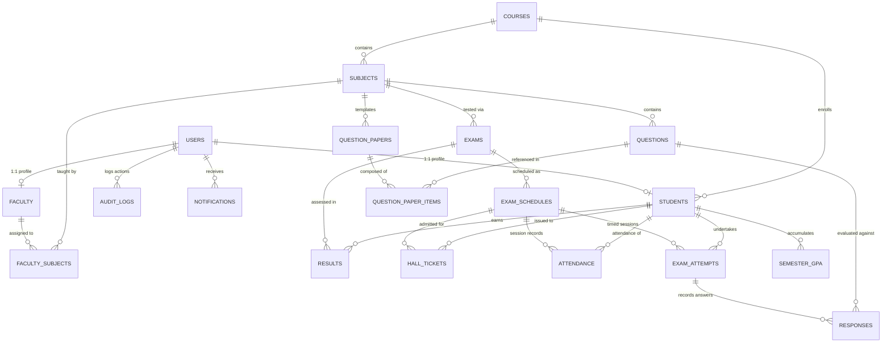

# Examination Management System (EMS) — Entity Relationship Diagram & Schema Specification

Strictly conforming to **SRS Version 1.0 (Chapter 7: Database Design)**.

---

## 1. Relational Entity Overview

The system strictly utilizes **PostgreSQL** via **Prisma ORM**. All relationships are enforced at the database level using primary keys, foreign keys, unique constraints, and check conditions.

---

## 2. Relational Schema Data Dictionary

### 2.1 `users`
*Represents authenticable actors with strict role-based access control and security lockout tracking.*
| Column | Type | Constraints | Description |
|---|---|---|---|
| `user_id` | `INT` | `PK`, `AUTO_INCREMENT` | Unique identifier |
| `full_name` | `VARCHAR(100)` | `NOT NULL` | Legal full name |
| `email` | `VARCHAR(150)` | `UNIQUE`, `NOT NULL` | Login identifier |
| `password_hash` | `VARCHAR(255)` | `NOT NULL` | bcrypt hash ($\ge 12$ rounds) |
| `role` | `ENUM` | `NOT NULL` | `Admin`, `Faculty`, `Student`, `Examiner` |
| `status` | `ENUM` | `DEFAULT 'active'` | `active`, `inactive`, `locked` |
| `failed_attempts` | `INT` | `DEFAULT 0` | Consecutive failed password counter |
| `locked_until` | `TIMESTAMP` | `NULLABLE` | Locked until timestamp (15-min lockout) |
| `created_at` | `TIMESTAMP` | `DEFAULT NOW()` | Record creation timestamp |

### 2.2 `students`
*Student academic master profile.*
| Column | Type | Constraints | Description |
|---|---|---|---|
| `student_id` | `INT` | `PK`, `AUTO_INCREMENT` | Unique student record ID |
| `user_id` | `INT` | `FK (users)`, `UNIQUE`, `NOT NULL` | 1-to-1 link to user credentials |
| `enrollment_no` | `VARCHAR(20)` | `UNIQUE`, `NOT NULL` | Format: `YYYY-COURSE-XXX` |
| `course_id` | `INT` | `FK (courses)`, `NOT NULL` | Enrolled degree course |
| `batch_year` | `INT` | `NOT NULL` | Academic admission cohort year |
| `attendance_pct` | `DECIMAL(5,2)` | `DEFAULT 0.00` | Cumulative percentage ($\ge 75\%$ required) |

### 2.3 `faculty`
*Faculty institutional record.*
| Column | Type | Constraints | Description |
|---|---|---|---|
| `faculty_id` | `INT` | `PK`, `AUTO_INCREMENT` | Unique faculty ID |
| `user_id` | `INT` | `FK (users)`, `UNIQUE`, `NOT NULL` | 1-to-1 link to user credentials |
| `department` | `VARCHAR(100)` | `NOT NULL` | Department affiliation |
| `designation` | `VARCHAR(50)` | `NOT NULL` | Academic ranking/title |

### 2.4 `courses`
*Academic programs.*
| Column | Type | Constraints | Description |
|---|---|---|---|
| `course_id` | `INT` | `PK`, `AUTO_INCREMENT` | Course ID |
| `course_name` | `VARCHAR(100)` | `UNIQUE`, `NOT NULL` | Degree program name |
| `duration_years` | `INT` | `NOT NULL` | Standard curriculum span |

### 2.5 `subjects`
*Individual curricular subjects.*
| Column | Type | Constraints | Description |
|---|---|---|---|
| `subject_id` | `INT` | `PK`, `AUTO_INCREMENT` | Subject ID |
| `subject_code` | `VARCHAR(20)` | `UNIQUE`, `NOT NULL` | Code identifier (e.g. `CS501`) |
| `subject_name` | `VARCHAR(100)` | `NOT NULL` | Descriptive course title |
| `course_id` | `INT` | `FK (courses)`, `NOT NULL` | Parent course program |
| `semester` | `INT` | `NOT NULL` | Semester number (1 to 10) |
| `credits` | `INT` | `NOT NULL` | Academic credit weighting ($\ge 1$) |

### 2.6 `faculty_subjects`
*Junction table for faculty assignment.*
| Column | Type | Constraints | Description |
|---|---|---|---|
| `id` | `INT` | `PK`, `AUTO_INCREMENT` | Record ID |
| `faculty_id` | `INT` | `FK (faculty)`, `NOT NULL` | Assigned faculty member |
| `subject_id` | `INT` | `FK (subjects)`, `NOT NULL` | Assigned subject |
| `is_coordinator` | `BOOLEAN` | `DEFAULT FALSE` | Only one primary coordinator allowed per subject |
| Unique constraint: `[faculty_id, subject_id]` |

### 2.7 `exams`
*Examination master records.*
| Column | Type | Constraints | Description |
|---|---|---|---|
| `exam_id` | `INT` | `PK`, `AUTO_INCREMENT` | Exam identifier |
| `subject_id` | `INT` | `FK (subjects)`, `NOT NULL` | Subject tested |
| `exam_type` | `ENUM` | `NOT NULL` | `Internal`, `External`, `Online` |
| `total_marks` | `INT` | `NOT NULL` | Maximum possible marks |
| `duration_minutes` | `INT` | `NOT NULL` | Standard duration allocated |

### 2.8 `exam_schedules`
*Scheduled sessions with room allocation and conflict checks.*
| Column | Type | Constraints | Description |
|---|---|---|---|
| `schedule_id` | `INT` | `PK`, `AUTO_INCREMENT` | Schedule session ID |
| `exam_id` | `INT` | `FK (exams)`, `NOT NULL` | Parent exam specification |
| `exam_date` | `DATE` | `NOT NULL` | Day of test |
| `start_time` | `VARCHAR(10)` | `NOT NULL` | 24-hr start time (e.g. `09:30`) |
| `end_time` | `VARCHAR(10)` | `NOT NULL` | 24-hr end time (e.g. `12:30`) |
| `venue` | `VARCHAR(100)` | `NOT NULL` | Hall / Computer Lab room number |
| `is_published` | `BOOLEAN` | `DEFAULT FALSE` | Visibility to students |

### 2.9 `hall_tickets`
*Official examination admit cards.*
| Column | Type | Constraints | Description |
|---|---|---|---|
| `hallticket_id` | `INT` | `PK`, `AUTO_INCREMENT` | Internal ticket ID |
| `ticket_number` | `VARCHAR(50)` | `UNIQUE`, `NOT NULL` | Format: `HT-YYYYMMDD-XXXX` |
| `student_id` | `INT` | `FK (students)`, `NOT NULL` | Candidate |
| `schedule_id` | `INT` | `FK (exam_schedules)`, `NOT NULL` | Session |
| `is_approved` | `BOOLEAN` | `DEFAULT TRUE` | Administrative validation flag |
| `issued_at` | `TIMESTAMP` | `DEFAULT NOW()` | Date and time generated |
| Unique constraint: `[student_id, schedule_id]` |

### 2.10 `questions`
*Question bank master records.*
| Column | Type | Constraints | Description |
|---|---|---|---|
| `question_id` | `INT` | `PK`, `AUTO_INCREMENT` | Question ID |
| `subject_id` | `INT` | `FK (subjects)`, `NOT NULL` | Linked subject |
| `creator_id` | `INT` | `FK (faculty)`, `NOT NULL` | Author faculty member |
| `question_text` | `TEXT` | `NOT NULL` | Question description / prompt |
| `question_type` | `ENUM` | `NOT NULL` | `MCQ`, `ShortAnswer`, `Essay` |
| `difficulty` | `ENUM` | `NOT NULL` | `Easy`, `Medium`, `Hard` |
| `marks` | `INT` | `NOT NULL` | Weighting marks |
| `unit` | `INT` | `NOT NULL` | Syllabus module (1-5) |
| `tags` | `VARCHAR(255)` | `NULLABLE` | Comma-separated search tags |
| `options` | `JSONB` | `NULLABLE` | Array of choices for MCQs |
| `correct_answer` | `TEXT` | `NOT NULL` | Answer key (hidden from students) |
| `is_published` | `BOOLEAN` | `DEFAULT TRUE` | Available for paper generation |

### 2.11 `question_papers` & `question_paper_items`
*Relational generated question papers.*
- `question_papers`: `paper_id` (PK), `subject_id` (FK), `title`, `total_marks`, `version`, `status` (`Draft`, `UnderReview`, `Approved`, `Published`, `Rejected`), `examiner_feedback`.
- `question_paper_items`: `id` (PK), `paper_id` (FK), `question_id` (FK), `marks`, `order_index`. Unique: `[paper_id, question_id]`.

### 2.12 `exam_attempts` & `responses`
*Live proctored online exam session persistence.*
- `exam_attempts`: `attempt_id` (PK), `student_id` (FK), `schedule_id` (FK), `start_time`, `deadline`, `submit_time`, `status` (`NotStarted`, `InProgress`, `Submitted`, `AutoSubmitted`, `UnderEvaluation`, `Evaluated`), `tab_switches`. Unique: `[student_id, schedule_id]`.
- `responses`: `response_id` (PK), `attempt_id` (FK), `question_id` (FK), `student_answer`, `marks_awarded`, `is_evaluated`. Unique: `[attempt_id, question_id]`.

### 2.13 `attendance`
*Session attendance tracking.*
- `attendance_id` (PK), `student_id` (FK), `schedule_id` (FK), `status` (`Present`, `Absent`), `recorded_by` (FK), `marked_at`.
- Unique constraint: `[student_id, schedule_id]` (prevents duplicates).

### 2.14 `results`
*Evaluation marks and grade records.*
- `result_id` (PK), `student_id` (FK), `exam_id` (FK), `marks_obtained`, `max_marks`, `grade`, `grade_points`, `moderation_status` (`Pending`, `Approved`, `Flagged`), `is_published`.
- Unique constraint: `[student_id, exam_id]`.

### 2.15 `audit_logs`
*Append-only system security and action logs.*
- `log_id` (PK), `user_id` (FK nullable), `action`, `resource`, `resource_id`, `ip_address`, `details` (JSONB), `timestamp`.
- Strict rule: No UPDATE or DELETE mutations are exposed anywhere in application logic.
